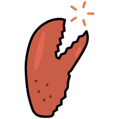

<div align="center">
  
  <h1>Pincer</h1>
  <p>Linux desktop control for AI agents over MCP.</p>
</div>

## About this fork

Pincer is a fork of Cua Driver, taken from `libs/cua-driver` in
[trycua/cua](https://github.com/trycua/cua) at commit `e6a244a8d`. It is
licensed under the MIT License; see [LICENSE](LICENSE).

The project is named Pincer, but the binary, crate names, CLI name, and
environment variable prefixes are still `cua-driver` and `CUA_DRIVER_*`.
Renaming them is out of scope for now, so every command in this repository
still uses `cua-driver`.

Changes from upstream:

- Linux gains a `capture_series` tool, which takes screenshots on a schedule
  and can stop early once the image stops changing, and an optional `region`
  crop for `get_desktop_state`.
- PostHog telemetry is removed at compile time.
- The optional perception extension is removed, together with the
  `parse_visual_regions` tool, the extension installer, the
  `install_extension` tool, and the `cua-perception` worker.
- The update check is removed: the startup check, the `check-update`,
  `update` and `channel` commands, and the `check_for_update` tool. The
  driver never looks up releases or runs Cua's installer, so it cannot
  replace itself with an upstream build. The removed commands exit with a
  note to pull and rebuild instead. `CUA_DRIVER_RS_UPDATE_CHECK` no longer
  has any effect.
- `skills install` and `skills update` write the skill pack built into the
  binary instead of downloading it from GitHub, so they work offline.
  `--from main` is refused.

The driver makes no network calls of its own; the browser tools only talk to
a browser on this machine through its loopback debugging port.
`install_ffmpeg` with `confirm: true` runs the system package manager, which
downloads ffmpeg from that package manager's sources.

This fork publishes no release binaries, Python wheels, or npm packages, and
upstream's release installer scripts are removed. Build it from source as
described below. The fork's own changes target Linux;
the macOS and Windows code from upstream is still in the tree.

See [MCP protocol and skills](docs/mcp-protocol-and-skills.md) for the modern
stdio profile, legacy compatibility, bundled skill resources, and HTTP limits.

## Build from source

1. Install [rustup](https://rustup.rs/). `rust/rust-toolchain.toml` pins Rust
   1.97.1 with the `rustfmt` component. rustup installs that toolchain the
   first time you run `cargo` in `rust/`, unless its auto-install setting is
   disabled; `rustup toolchain install` run in `rust/` installs it up front.
2. Build the driver.

   ```bash
   cd rust
   cargo build --release -p cua-driver
   ```

3. The binary is `rust/target/release/cua-driver` (`cua-driver.exe` on
   Windows). If `CARGO_TARGET_DIR` is set, it is
   `$CARGO_TARGET_DIR/release/cua-driver` instead. The workspace uses Cargo's
   standard `release` profile.
4. Check that the driver can reach the current graphical session.

   ```bash
   rust/target/release/cua-driver doctor
   ```

On Linux, the driver must run in the graphical user's session and share its
AT-SPI session bus.

## Connect an agent

Register the binary with Claude Code for your user account, using its
absolute path.

```bash
claude mcp add --scope user pincer -- /path/to/cua-driver mcp
```

The agent cursor overlay is on by default: an arrow that shows where the
driver points, clicks and types, and follows every pointer move it makes.
Add `--no-overlay` to turn it off. On Linux and Windows, `cua-driver mcp` owns
its runtime directly and shuts it down when stdin closes.

On Linux, you can also deny the driver network access by starting it with
`unshare -cn`, which runs it in a new user and network namespace whose only
interface is a loopback device that is down.

```bash
claude mcp add --scope user pincer -- \
  unshare -cn /path/to/cua-driver mcp
```

This needs unprivileged user namespaces. Inside the namespace the driver
cannot open TCP/IP connections, including to a browser's loopback debugging
port, so the browser tools do not work. Abstract Unix sockets are isolated as
well (see `network_namespaces(7)`); Unix sockets with a filesystem path are
not.

`cua-driver mcp-config --client <name>` prints setup for other MCP clients.

### Claude Code computer-use compatibility

If you want Claude Code's vision/computer-use-style flow to ground on window
screenshots from the driver, register the compatibility mode.

```bash
claude mcp add --transport stdio cua-computer-use -- /path/to/cua-driver mcp --claude-code-computer-use-compat
```

This keeps the driver's normal MCP tools and changes only `screenshot`, which
requires `pid` and `window_id` and captures that window only.

Use MCP for this Claude Code vision/computer-use-style path. CLI screenshots
still work as driver calls, but they do not expose the
`mcp__cua-computer-use__screenshot` tool name that Claude Code appears to use
as the image-grounding cue.

## Agent skill pack

The skill pack in `rust/Skills/cua-driver` is compiled into the binary. The
MCP server serves it as resources, and `cua-driver skills install` writes the
same copy into detected agent directories without downloading anything. The
direct installer keeps only the host OS document unless `--all-platforms` is
used. The `@cua/driver` skill on ClawHub is upstream's, not this fork's.

## Integration surfaces

- **Agent MCP or CLI:** MCP-capable agents connect directly to
  `cua-driver mcp`; shell-oriented agents and automation can use
  `cua-driver call`. No generated language client is required.
- **Application SDK:** Python applications import `cua_driver`; TypeScript
  applications import `@trycua/cua-driver`. Both package roots call the same
  in-process native runtime through generated UniFFI bindings. The safe Rust
  SDK and generated bindings sit above a versioned C ABI; they do not require
  a daemon for direct application use.

The language packages are for client applications, not agents. They contain no
language-native MCP facade and have no `/sdk`, `/mcp`, or `/native` public
suffix. MCP remains implemented by the `cua-driver` executable as the
runtime-neutral agent boundary.

The package names in `python/pyproject.toml` (`cua-driver`) and
`typescript/package.json` (`@trycua/cua-driver`) are upstream's. This fork
publishes neither, so a package installed under those names from PyPI or npm
is not this fork.

## Computer History preview

Upstream's opt-in, encrypted history of actions performed through the driver
is still in the tree. The preview stores a strict metadata allowlist, stays
local, and exposes permission-gated `history_status` and `history_query` tools
for read-only agent hydration. It never stores screenshots, typed text,
clipboard contents, raw arguments or results, accessibility trees, paths,
window titles, or URLs.

[Try the Computer History desktop preview](docs/computer-history-preview.md)
covers enabling, inspection, and deletion; its install and uninstall commands
fetch upstream builds and do not apply to this fork. The [architecture and
staged plan](docs/computer-history-architecture.md) defines the format,
security boundary, release gates, and later NVIDIA OpenShell integration.

## Permission modes

`standard` is the promptless default for normal automation. `bounded` admits
only the tools and resources in a reviewed manifest. `unrestricted` requires
`--dangerously-bypass-approvals`.

The mode belongs to the process that owns the runtime and is fixed at launch:
`cua-driver serve` takes the flags, while `cua-driver mcp` and embedding hosts
use the matching `CUA_DRIVER_PERMISSION_MODE`,
`CUA_DRIVER_CAPABILITY_MANIFEST_FILE`, and
`CUA_DRIVER_CAPABILITY_MANIFEST_APPROVED` variables. Choose it before starting
the daemon; a running daemon must be restarted to change it.

Attaching to an existing logged-in Chromium profile remains explicit:

```bash
cua-driver mcp --grant existing-profile
```

An embedding application can instead provide `DriverAuthorizationHost`, and a
bounded runtime can declare `kind: existing_profile` in its manifest. The
driver does not render its own authorization modal or banner.

See [`rust/Skills/cua-driver/RUNTIME.md`](rust/Skills/cua-driver/RUNTIME.md)
for the permission modes, capability manifests, and authorization rules.

## Repository layout

| Path                                | Purpose                                                                |
| ----------------------------------- | ---------------------------------------------------------------------- |
| `rust/`                             | Cargo workspace for the daemon, UniFFI SDK, platform crates, and tests |
| `python/`                           | Python SDK, bundled-binary wrapper, and package tests                  |
| `contract/`                         | Experimental generated SDK contract and fixtures                       |
| `typescript/`                       | Generated TypeScript SDK                                               |
| `tests/fixtures/`                   | Source-built GUI harness apps and shared fixtures                      |
| `rust/crates/cua-driver/tests/`     | Hermetic Rust integration tests for the driver                         |
| `rust/crates/cua-driver-e2e/tests/` | Desktop E2E suites for the GUI harnesses                               |
| `scripts/`                          | Local build-and-install, uninstall, and VM sync helpers                |
| `docs/`                             | Repo-local specs, design notes, and historical plans                   |

Start with `rust/README.md`, `rust/crates/cua-driver-e2e/tests/README.md`, and
`tests/fixtures/README.md` when changing driver behavior or tests.

Upstream drives the complete Rust harness catalog from canonical GUI runner
scripts under `scripts/ci/`; those scripts are not part of this repository.
See [`docs/test-harnesses-guide.md`](docs/test-harnesses-guide.md) and, for
preparing a macOS Lume worker, [`tests/runners/macos-lume/README.md`](tests/runners/macos-lume/README.md).
Keep build artifacts, VM logs, and local verification journals out of git
unless they become a stable fixture or contributor doc.

The contract-first SDK architecture is documented in
[`contract/README.md`](contract/README.md). The Rust contract crate generates
the checked-in manifest and supplies the typed inputs used by the live daemon
and UniFFI SDK.

The imported SDK bindings are generated by
`scripts/generate-uniffi-bindings.mjs`. `CuaDriver.create()` loads the native
runtime in the application process; the daemon-compatible `connect()` path is
retained for external clients. The stable native boundary is declared in
[`rust/include/cua_driver_abi.h`](rust/include/cua_driver_abi.h). That header is
generated from the Rust `#[repr(C)]` exports with
`cargo run -p cua-driver-bindgen --bin cua-driver-abi-header`; running the
same command with `--check` confirms that the implementation and the header
have not drifted. UniFFI separately generates its private FFI scaffolding and
the Python and TypeScript SDK bindings; that implementation-specific
scaffolding is not the stable public `cua_driver_*_v1` C contract.

For direct agent integrations, see the
[`examples/agent-sdks`](examples/agent-sdks/README.md) Codex and Claude Agent
SDK examples. They connect the agent to `cua-driver mcp` without importing a
generated client.

Contributor documentation:

- `docs/cursor-themes.md` documents the default semantic cursor and custom
  dotLottie authoring contract.
- `docs/test-matrix.md` maps unit and canonical harness E2E suites.
- `docs/action-support.md` is the empirical platform behavior ledger.
- `docs/test-harnesses-guide.md` explains fixture and runner ownership.
- `docs/linux-desktop-validation.md` covers representative Linux sessions.
- `docs/linux-support-completion-plan.md` preserves the historical Linux plan.

## macOS process identity and permissions

This fork ships no prebuilt `CuaDriver.app`. On macOS,
`scripts/install-local.sh` builds a separate `CuaDriverLocal.app` from this
checkout.

macOS attributes Accessibility and Screen Recording grants to a responsible app identity, not simply to an executable path. Use one of these supported launch modes:

- **Standalone:** install `CuaDriver.app`, grant permissions to it, and start its daemon with `open -n -g -a CuaDriver --args serve`. The installed `cua-driver mcp` CLI may proxy through this daemon automatically.
- **Explicit direct MCP:** `cua-driver mcp --direct` makes the MCP process own
  its runtime. On macOS this deliberately uses the spawning host's TCC
  attribution and does not provide the AppKit cursor overlay without a
  certified host adapter.
- **Embedded:** have the macOS app that owns the grants use the generated `EmbeddedCuaDriverHost` to spawn a private daemon and return both SDK and MCP connection details. The daemon stays in the app's responsibility chain and inherits its grants. A gateway, terminal, or unrelated helper must not spawn the daemon on the app's behalf. `@trycua/cua-driver/embedded` is an organizational alias for the same Rust host exported at the package root; it has no separate lifecycle implementation.

Directly spawning a raw `cua-driver serve` outside `CuaDriver.app` without embedded mode is unsupported: it has no stable bundle identity for TCC attribution. Do not grant permissions to arbitrary binary paths or rely on that configuration in production. See [`rust/Skills/cua-driver/EMBEDDING.md`](rust/Skills/cua-driver/EMBEDDING.md) for the embedding contract and examples.
